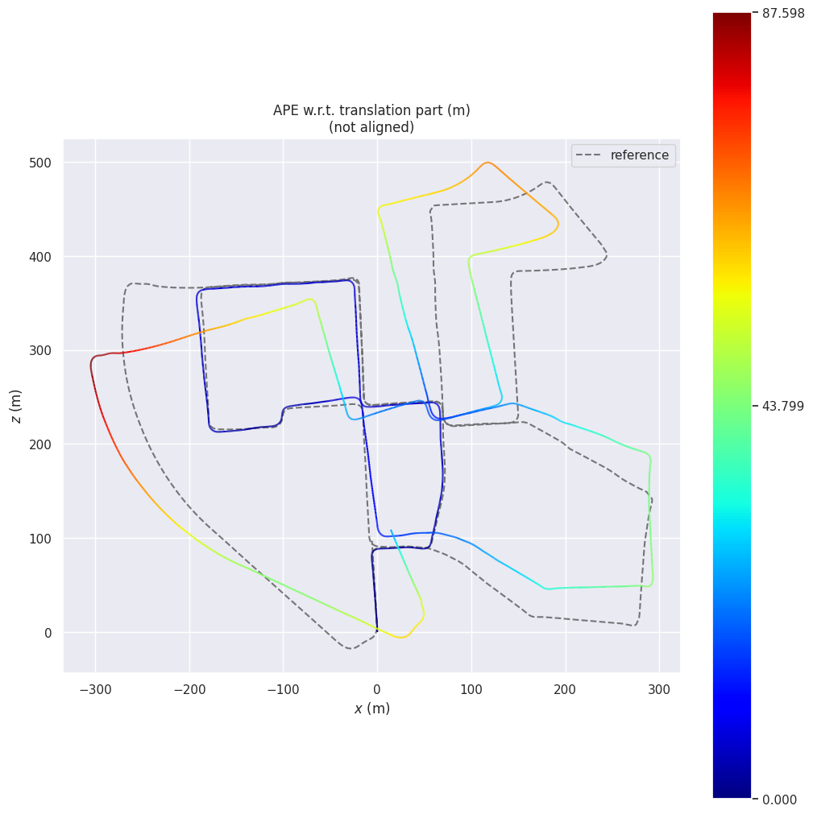
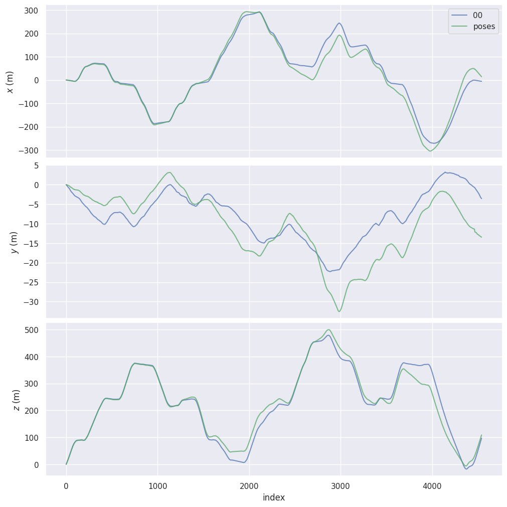

# Stereo Visual Odometry on KITTI (seminar code, corrected)
This branch holds the original seminar code (`VO_base.py`, `VO_constrained.py`, `filter.py`, `utils.py`) with the corrections that were found and fixed later. The maintained version of the pipeline is the `kitti_slam` package on the `main` branch. With the same parameters, both produce byte-identical trajectories on all 11 labeled sequences in both configurations.

The original code, as it produced the results in `VO_Seminar.pdf`, is commit `b8796f7`. Statements in the report that do not match that code are corrected in [VO_Seminar_errata.md](VO_Seminar_errata.md).

# Setting up the Environment
Create a Python virtual environment and install all dependencies using:

```bash
pip install -r requirements.txt
```

This installs the EVO tool used for evaluation.

# Running Base Pipeline
To run the base visual odometry pipeline, use the following command:

```bash
python VO_base.py
```

This script loads configuration from `config/base.yaml`. By default, it processes all 11 sequences (0-10) from the KITTI dataset and outputs results to the `results/base` directory. The KITTI dataset path is specified in the `dataset_path` parameter in `config/base.yaml`.

### Customizing the Base Pipeline
- **Sequences**: To specify which sequences to process, edit the `sequences` list in `config/base.yaml`. For example:
  ```
  sequences: [0, 4, 7]
  ```
  This will run only sequences 00, 04, and 07.
- **Output Directory**: To change the output folder (where poses.txt files are saved for each sequence), modify the `output_dir` parameter in `config/base.yaml`. For example:
  ```
  output_dir: results/base_custom
  ```
- **Other Parameters**: Additional tunable parameters include `nfeatures` (number of ORB features), `scale` (ORB scale factor), `nlevels` (ORB pyramid levels), `matching_norm` (e.g., NORM_HAMMING), `temporal_cross_check` and `stereo_cross_check` (cross-checking for the temporal and the stereo matcher), `min_abs_w` (triangulated point validity, see below), `pnp_confidence`, `pnp_iterations_count`, and `pnp_min_inliers` (minimum number of PnP inliers). Adjust these as needed for experimentation, but default values are provided in the YAML file.

The script will create subdirectories for each sequence in the specified output directory and save the estimated trajectory as `poses.txt`.

# Running Constrained Pipeline
To run the constrained visual odometry pipeline (which includes additional filters like depth thresholds, motion constraints, and grid-based feature clustering), use the following command:

```bash
python VO_constrained.py
```

This script loads configuration from `config/constrained.yaml`. By default, it processes all 11 sequences (0-10) from the KITTI dataset and outputs results to the `results/constrained` directory. The KITTI dataset path is specified in the `dataset_path` parameter in `config/constrained.yaml`.

### Customizing the Constrained Pipeline
- **Sequences**: To specify which sequences to process, edit the `sequences` list in `config/constrained.yaml`. For example:
  ```
  sequences: [0, 4, 7]
  ```
  This will run only sequences 00, 04, and 07.
- **Output Directory**: To change the output folder, modify the `output_dir` parameter in `config/constrained.yaml`. For example:
  ```
  output_dir: results/constrained_custom
  ```
- **Other Parameters**: This pipeline has more parameters for fine-tuning, including:
  - Feature detection: `nfeatures`, `scale`, `nlevels`, `grid_size` (e.g., [50, 30]), `max_per_grid`.
  - Depth and uncertainty filters: `min_depth_multiplier` (multiplied by baseline for minimum depth), `relative_depth_uncertainty_threshold`, `min_abs_w` (triangulated point validity, see below).
  - Motion constraints: `max_translation` (max allowed translation in meters), `max_pitch_deg` (max allowed rotation about the camera y axis in degrees; despite the name, this is the heading change, not pitch).
  - Matching: `matching_norm`, `temporal_inlier_threshold` (fraction of the best temporal matches kept, not a ratio test), `temporal_cross_check`, `stereo_cross_check`, `stereo_pixel_threshold`, `stereo_max_hamming_distance`, `stereo_ratio_test`, `stereo_max_disparity`.
  - PnP: `pnp_confidence`, `pnp_iterations_count`, `pnp_min_inliers`.
  - Other: `orthogonalize_alpha` for planar motion orthogonalization.
  
  Default values are provided in the YAML file. Adjust them based on your needs, such as increasing `nfeatures` for denser matching or tightening `max_translation` for stricter motion constraints.

The script will create subdirectories for each sequence in the specified output directory and save the estimated trajectory as `poses.txt`.

### Skipped frames
In both pipelines, a frame is skipped when no temporal match has a stereo match, when fewer than 4 valid points remain, when PnP fails or finds fewer than `pnp_min_inliers` inliers, or (constrained only) when the motion exceeds `max_translation` or `max_pitch_deg`. A skipped frame assumes constant velocity: its pose is propagated with the last accepted relative transformation, and the next frame is registered against it. With the default configurations, no frame of the 11 labeled sequences is skipped.

# Corrections
These corrections were made after the seminar. Each one is its own commit on this branch. The effects were measured with the 100 m RPE and the KITTI segment drift (see below).

| Correction | Before | After | Effect on the 11 labeled sequences |
|---|---|---|---|
| Multi-sequence runs | The second sequence of a run crashed after clearing its `poses.txt` (`matching_norm` was converted inside the sequence loop). This truncated the committed `output_base/01/poses.txt` | `matching_norm` is converted once; results go to `results/` by default | Every configured sequence runs |
| Constant velocity | A skipped frame kept the previous pose in base (zero velocity); constrained repeated the last motion | Both pipelines propagate the last accepted relative transformation on every skipped frame | None: no frame was skipped before the other corrections |
| Triangulated point validity (`min_abs_w`) | Every triangulated point reached PnP, including points behind the cameras and points at near-infinite depth (zero disparity) | Points must be finite, in front of both cameras, and have `\|w\| >= min_abs_w` (unit-norm homogeneous coordinates; `1.0e-4` rejects points beyond about 10 km) | Base only: 2.8% (seq 04) to 20.1% (seq 01) of points rejected; APE improves on 7 sequences (seq 01: 522.8 → 417.8 m) and worsens on 4 (seq 08: 101.4 → 112.4 m). Constrained is unchanged |
| PnP result (`pnp_min_inliers`) | The return value of `solvePnPRansac` was ignored | A pose is accepted only if PnP succeeds with a finite pose and at least `pnp_min_inliers` inliers (6 rejects solves with no inlier beyond the 5-point minimal sample) | One frame (constrained seq 01, frame 435, 5 inliers) was skipped; after the stereo matching correction below it has 7 inliers and is registered |
| Grid cells | The partial bottom row and right column of the grid were merged into their neighbours | They are cells of their own | None: ORB keeps keypoints 31 px from the border, so no keypoint falls in these strips |
| Rectified stereo matching | The best and second-best descriptors were chosen among all keypoints in the row band, then the best was rejected if its disparity was invalid | Only keypoints in the row band and the disparity range compete; the ratio test compares valid candidates only | Constrained only: +0.4% (seq 04) to +5.7% (seq 01) stereo matches. On highway seq 01 the added matches are mostly far; rotation error falls and translation error rises (APE 345.7 → 365.0 m) |
| Base stereo cross-check | One `cross_check` value served both matchers of the base pipeline | `temporal_cross_check` and `stereo_cross_check` | None with the default values |
| Evaluation script | RPE used 100 frames, not 100 m; the sequence argument of `create_results.sh` had no effect | RPE over 100 m with pairs chosen on the ground truth; APE and RPE also for rotation (rad) | See below |
| Unused code | `VO_BA.py` and `bundle_adjustment.py` (bundle adjustment was never run), the planar 2-point PnP, `VO_code.zip` | Removed | — |

# Creating EVO Results
To evaluate the estimated trajectories using the EVO tool, run the following commands (assuming you have ground truth files from the KITTI dataset in a known path, e.g., `poses/`). All errors are in SI units: translation errors in m, rotation errors in rad.

For Absolute Pose Error (APE) calculation (no alignment; the trajectories start at the ground-truth frame 0 pose):

```bash
evo_ape kitti ./path_to_ground_truth/poses/XX.txt ./path_to_estimated_trajectory/poses.txt -p --plot_mode xz
evo_ape kitti ./path_to_ground_truth/poses/XX.txt ./path_to_estimated_trajectory/poses.txt --pose_relation angle_rad
```

For Relative Pose Error (RPE) calculation over 100 meters:

```bash
evo_rpe kitti ./path_to_ground_truth/poses/XX.txt ./path_to_estimated_trajectory/poses.txt -p --plot_mode xz --delta 100 --delta_unit m --all_pairs --pairs_from_reference
evo_rpe kitti ./path_to_ground_truth/poses/XX.txt ./path_to_estimated_trajectory/poses.txt --delta 100 --delta_unit m --all_pairs --pairs_from_reference --pose_relation angle_rad
```

`--all_pairs --pairs_from_reference` pairs every frame with the frame about 100 m ahead on the ground-truth path (within 10%), so different estimates of a sequence are compared on the same pairs. Without `--delta_unit m`, evo uses frames: `--delta 100` alone is a 100-frame interval.

For Trajectory comparison:

```bash
evo_traj kitti --ref ./path_to_ground_truth/poses/XX.txt ./path_to_estimated_trajectory/poses.txt -p --plot_mode xyz
```

Replace `XX` with the sequence number (e.g., 00), `./path_to_ground_truth/` with the actual ground truth directory, and `./path_to_estimated_trajectory/` with your output (e.g., `results/base/00/`).

The official KITTI score (mean translational and rotational drift over 100–800 m segments) is not computed by EVO. The `kitti_slam` package on the `main` branch computes it (`kitti_segments` profile).

# Saving All Results Using a Script
To automate running the above EVO commands for all (or specific) sequences and save the results (text files and plots) in the output folder, use the bash script:

```bash
./create_results.sh <path_to_output_folder>
```

Replace `<path_to_output_folder>` with the path to the folder containing the output data (e.g., the one specified in your YAML config), such as:

```bash
./create_results.sh ./results/constrained/
```

By default, the script processes all sequences (00-10) found in the output folder. To process a specific sequence, provide it as an additional argument:

```bash
./create_results.sh <path_to_output_folder> <sequence_name>
```

For example:

```bash
./create_results.sh ./results/constrained/ 01
```

The script reads ground truth files from `./poses/`, or from `./ground_truth/poses/` if `./poses/` does not exist. It will generate APE, RPE, and trajectory files/plots in each sequence's subdirectory, and exits with a non-zero status if any evaluation fails.

# Viewing the Results
After running the EVO commands or the script, you can find the generated results in the specified output folder's sequence subdirectories. These include:
- Text files: `ape_results.txt` and `rpe_results.txt` (translation, m), `ape_rotation_results.txt` and `rpe_rotation_results.txt` (rotation, rad).
- Plots: e.g., `ape_plot_map.png` (APE error map), `trajectory_plot_xyz.png` (3D trajectory overlay), `rpe_plot_map.png` (RPE errors).

For interpretation:
- **APE** measures global consistency (total drift).
- **RPE** measures local accuracy (the error accumulated over 100 m).
- Lower errors indicate better odometry performance. Compare against KITTI benchmarks for context.

# Historical Results
`output_base/` and `output_constrained/` hold the results reported in `VO_Seminar.pdf`. They were produced by the original code (commit `b8796f7`), before the corrections above, and their RPE values use a 100-frame interval. `output_base/01/poses.txt` holds only the first pose (see the first correction); its `ape_results.txt` and `rpe_results.txt` were computed from the complete earlier trajectory (`git show 9f15e7c:output_base/01/poses.txt`). The figures (`*.png`, `keypoints/`, `output_features/`) belong to the report; `detectors.py` draws the SIFT/ORB keypoint comparisons in `keypoints/`, and `features.py` the brute-force and rectified stereo matches.

Example plots from sequence 00 in `output_constrained/`:



